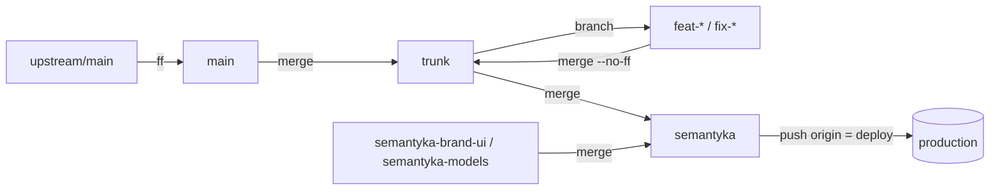

# Fork workflow

This repo is a fork of [`cgoinglove/better-chatbot`](https://github.com/cgoinglove/better-chatbot) that adds features and is deployed as the Semantyka (Ukrainian) chat app.

## 1. Remotes

| remote | URL | holds |
|---|---|---|
| `upstream` | github.com/cgoinglove/better-chatbot | upstream `main` |
| `fork` | github.com/theuargb/better-chatbot | `main` (mirror), `trunk`, feature branches |
| `origin` | github.com/neutrome-labs/semantyka-app-better-chatbot | `semantyka*` branches (deploy) |

## 2. Branches and roles

- `main`: pristine mirror of `upstream/main`. Never commit to it.
- `trunk`: integration branch. Every feature and fix lands here, with no Semantyka branding. Its migrations are the single source of truth for migration order.
- `feat-*` / `fix-*`: cut from `trunk`, pushed to `fork`, merged into `trunk` with `git merge --no-ff`.
- `semantyka-brand-ui` (UI branding, `messages/uk.json`) and `semantyka-models` (`src/lib/ai/models.ts`): Semantyka-only changes.
- `semantyka` = `trunk` + the two branding branches. This is production; pushing it to `origin` deploys.

**Never merge a `semantyka*` branch into `trunk`.** Branding must not leak into the integration branch.



Bump `@better-auth/stripe` together with `better-auth`: the plugin pins an exact `better-auth` version as a peer dependency.

## 3. Upstream sync

```sh
git checkout main && git merge --ff-only upstream/main && git push fork main
git checkout trunk && git merge --no-ff main && git push fork trunk
```

Merge, never rebase. If upstream adds migrations they arrive in `main` first; take them into `trunk` before generating any new fork migration.

## 4. Migration policy

Drizzle's pg migrator (`PgDialect.migrate`) only runs migrations whose journal `when` is greater than the newest `created_at` recorded in `drizzle.__drizzle_migrations`. A migration that is renumbered or sorts before one a database has already applied is **silently skipped** there, and later migrations that depend on it then fail at boot (migrations run from `src/instrumentation.ts`, or `scripts/postinstall.ts` on Vercel).

Rules:

1. Generate a migration only after merging the latest `trunk` into your feature branch.
2. If `trunk` gained migrations since then, delete your branch's `.sql`, its `meta/NNNN_snapshot.json` and its journal entry, then run `pnpm db:generate` again right before merging.
3. Never point a feature branch at a shared database.
4. Never edit or renumber a migration that already reached `trunk`.
5. `pnpm tsx scripts/check-migrations.ts --base fork/trunk` must pass before merging. CI runs the same check on PRs and pushes to `trunk` and `semantyka` (`.github/workflows/fork-ci.yml`).

## 5. Translations

New UI keys go into `messages/en.json` on the feature branch. Ukrainian strings go into `messages/uk.json` on `semantyka-brand-ui`, which is then merged into `semantyka`. Missing `uk` keys fall back to English (`src/i18n/request.ts` deep-merges with `en`).

## 6. Release to production

```sh
git checkout semantyka
git merge trunk
git merge semantyka-brand-ui semantyka-models
pnpm check-types && pnpm test && pnpm tsx scripts/check-migrations.ts --base origin/semantyka
git push origin semantyka
```

Migrations run at boot.

## 7. Known hazard: `0016_lonely_terror`

`feat-url-rewrites` once generated `0016_lonely_terror` (`when` 1785002568169) and that file reached `semantyka-staging`. On `trunk` the same table lives in `0017_bouncy_thunderbolts` (`when` 1785004151152), after `0016_curved_maggott` (`when` 1771768784529). A database that applied `0016_lonely_terror` skips `0016_curved_maggott` and then fails on `CREATE TABLE "url_rewrite"`.

Detect (healthy: no row with `created_at = 1785002568169`):

```sql
SELECT id, created_at FROM drizzle.__drizzle_migrations ORDER BY created_at DESC LIMIT 8;
```

Repair, in one transaction:

```sql
BEGIN;
DELETE FROM drizzle.__drizzle_migrations WHERE created_at = 1785002568169;
-- run the statements of src/lib/db/migrations/pg/0016_curved_maggott.sql by hand
INSERT INTO drizzle.__drizzle_migrations (hash, created_at) VALUES
  ('<sha256sum of 0016_curved_maggott.sql>', 1771768784529),
  ('<sha256sum of 0017_bouncy_thunderbolts.sql>', 1785004151152);
COMMIT;
```

Drizzle compares only `created_at`; the hash is stored for consistency. Restart the app so the remaining migrations apply.

## 8. One-time branch cleanup (run manually)

Archive, then delete the stale env branches on `origin`:

```sh
for b in semantyka-production semantyka-staging semantyka-staging-opennext \
         semantyka-staging-with-mcps semantyka-preview-codemode semantyka-app storeowner-demo; do
  git tag archive/$b origin/$b && git push origin archive/$b
  git push origin --delete $b
done
```

- Delete locally: `trunk-v2`, `feature/translation`, `feat/posthog-error-tracking`, `fix-mobile-keyboard-is-not-collapsed-after-message-sent` (and its `fork/` remote branch), plus every branch listed by `git branch --merged trunk` except `main` and `trunk`.
- GitHub: set the default branch of `origin` to `semantyka` (it is still the stale `semantyka-app`).
- Unmerged experiments (`feat-codemode`, `feat-expo-app`, `feat-opennext-experimental`, `feat-admin-stats-ex`, `feature-in-app-tool-pulse`, `feature-workflow-node-*`, `feature-mention*`, `feat/file-generator-tool-clean`) stay as branches on `fork`; rebase them on `trunk` only when revived.

## 9. Actions on the fork

`release.yml` and `container.yaml` fire on pushes to `main`. Disable them in the fork's Actions settings if you don't want release-please PRs or GHCR images from it.
